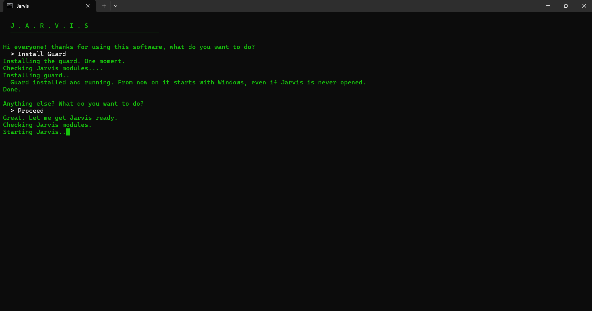
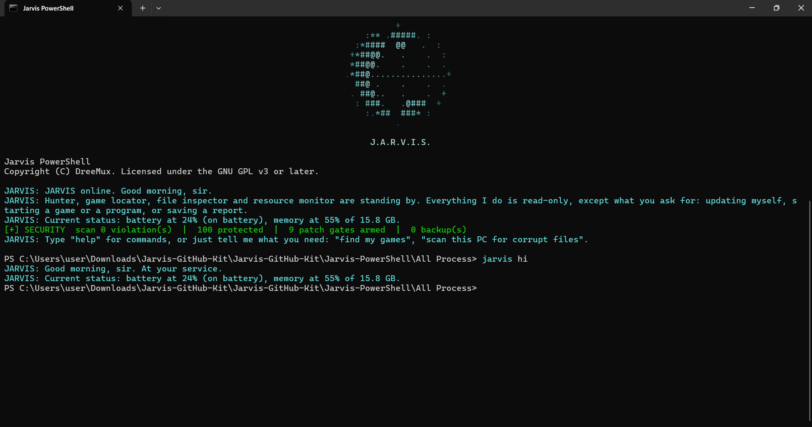
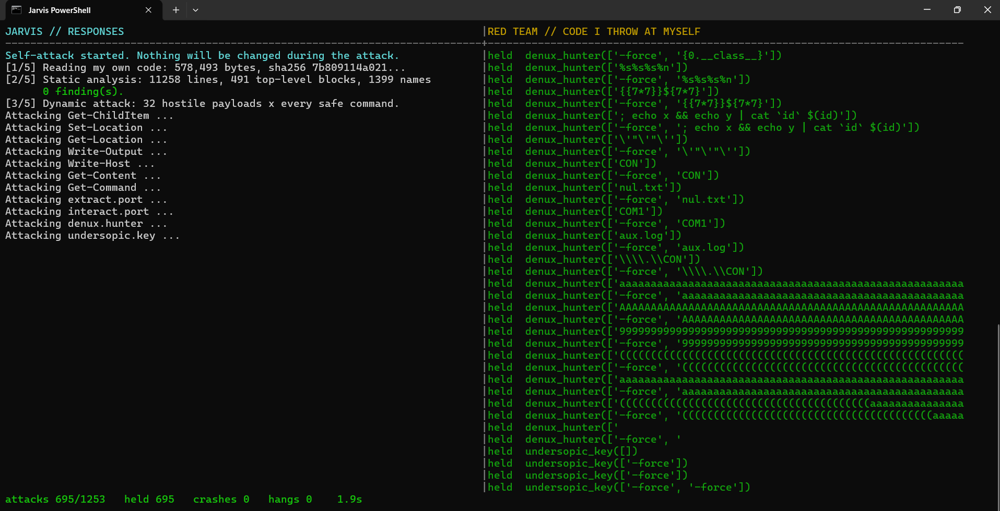

<div align="center">

# Jarvis PowerShell

### A Windows-PowerShell-style terminal you can talk to.

Find your games, hunt corrupted files, inspect any file and update itself safely, all from a console that looks like the one you already know. Read-only by default. Pure Python.


</div>

---

## What is it?


*The start screen: Jarvis greets you, then you pick Proceed, Install Guard or Delete Guard.*


*Talk to it in plain language, or type PowerShell-style commands.*


*Jarvis attacks its own commands with over 1,200 hostile payloads to hunt for vulnerabilities, edge cases, and crashes*

**Jarvis PowerShell** is a terminal that behaves like Windows PowerShell (same colours, same cmdlets, same error messages) with an assistant built in. You can type `dir` and `cd` as usual, or just say what you need:

> *"find my games"* · *"scan this PC for corrupt files"* · *"what's in this folder?"* · *"open data.win"*

It was written by **DreeMux** as a learning project and has grown over many versions from a 68 KB prototype into a modular program of about 11,000 lines. **Every version is kept in this repository**, so you can follow how it grew.

## Why you might like it

- **It understands sentences.** Plain-language requests (English, plus some Italian phrases) are matched to real tools, with no cloud needed for the built-in features.
- **It reads, it doesn't touch.** By default nothing of yours is written, moved or deleted. The few exceptions are things you ask for explicitly ([see the list](#what-it-can-write-or-run)).
- **It updates itself carefully.** `implement jarvis` runs **9 safety checks**, makes a backup and rolls back on failure.
- **It tests itself.** `maintenance` runs a health check and **203 self-tests** on every command.
- **Nothing to install.** Standard library only. Optional packages add extras.
- **It is open.** GPL-3.0-or-later, plain Python, readable in one evening.

## See it in action

Start-up and first reply, lightly shortened:

```text
JARVIS: JARVIS online. Good evening, sir.
JARVIS: Hunter, game locator, file inspector and resource monitor are standing by.
        Everything I do is read-only, except what you ask for: updating myself,
        starting a game or a program, or saving a report.
[+] SECURITY  scan 0 violation(s)  |  100 protected  |  9 patch gates armed  |  0 backup(s)
JARVIS: Type "help" for commands, or just tell me what you need.

PS C:\Users\you> find my games
JARVIS: As you wish, sir. Checking Steam, Epic, GOG, itch.io and your Downloads for data.win.
```

---

## Features

### PowerShell-style shell
- Familiar cmdlets with their aliases: `Get-ChildItem` (`dir`, `ls`), `Set-Location` (`cd`), `Get-Content` (`cat`), `Get-Help`, `Get-Command`, `Write-Output` and more.
- Errors are printed in the original PowerShell format, in red.

### Plain-language assistant
- Type a sentence, or start it with `jarvis`.
- Finds the `data.win` of your games in Steam, Epic, GOG, itch.io and Downloads, and starts a game with `jarvis open <game>`.
- A small built-in knowledge base: maths, units, dates, a security glossary and how-tos.

### File tools ("port tools")

| Command | What it does |
|---|---|
| `denux.hunter` | Hunts for corrupted files: the whole PC, a folder, or one selected file |
| `extract.port` | Shows everything about one file: metadata, type, checksums |
| `interact.port` | Shows what is inside a file and what you can do with it |
| `extract.key` | Saves a text report about the selected file (the file itself is never changed) |
| `pluton.key` | Files, memory and battery used around the selected file |
| `undersopic.key` | Finds the direct `data.win` of downloaded GameMaker games |

### Safe self-update
- `implement jarvis` checks: valid source, checksum, syntax, data block, security scan, updater intact, commands kept, start test, start speed. A backup is made first.
- Downloads need `https` and a SHA-256 hash.
- `security` shows an integrity report of the program.

### Online features (only when you ask)
- **Chrome mode** opens plain `https` pages (e-mail, Canva, YouTube search...). It never types, clicks or reads pages.
- `jarvis search <topic>` also asks Wikipedia, and `jarvis news` reads RSS feeds.
- **Voice** (optional, `voice on`, needs `pyttsx3`) is silent until you ask.

### Screen Watch (v3.1.0+, Windows only)
- Notices when someone may be watching your screen: Remote Desktop, VNC, TeamViewer, Zoom screen sharing, Chrome Remote Desktop, Quick Assist...
- Pauses Jarvis and opens a warning window. An optional **guard** runs at Windows start-up, even when Jarvis is closed.
- The **shield** reacts to a viewer by acting on Firefox. **By default it ends Firefox immediately, without asking you to save.** Change that with `watch shield hide`, `minimize`, `close` or `off`.

### Claude Code bridge (v3.2.0+)
- A request Jarvis cannot answer locally is handed to the installed [Claude Code](https://claude.com/claude-code) CLI with all tools disabled (a text answer only).
- It needs Claude Code installed and logged in with **your own account**. The text of the request is sent to Anthropic's servers.
- It is **on by default**. Turn it off with `claude off`.

---

## Requirements

- **Python 3** (developed and tested with Python 3.13).
- **Windows** for the full experience. The core shell and the file tools also run on Linux; Screen Watch and the guard are Windows only.
- Optional: `psutil` (live memory and CPU of a running game), `pyttsx3` (voice), `Pillow` (news photos), Claude Code (the bridge).

## Quick start

1. Click **Code ▸ Download ZIP** (or `git clone` this repository) and extract it.
2. Double-click **`start.bat`** and choose **Proceed**. The menu also offers *Install Guard* and *Delete Guard* for Screen Watch.
3. Type `help`, or just talk to it.

Prefer the command line? `cd "All Process"` and run `python pwsh.py`.

> **Windows SmartScreen says "unknown publisher"?** That is the standard warning for any downloaded file. Read the code first (it is plain Python), then right-click the ZIP ▸ **Properties** ▸ tick **Unblock** before extracting.

## Repository layout

```text
start.bat           double-click to start (the start menu)
Read Me.txt         the program's own manual (in English)
All Process/
  pwsh.py           the program that actually runs
  src/              the same code split into 23 modules (edit here)
  build.py          rebuilds pwsh.py from src/ and refuses to run on a syntax error
  launcher.py       the start menu
LICENSE             GNU General Public License v3 (full text)
NOTICE              copyright and license summary
```

Edit the modules in `src/`, then start Jarvis again: `build.py` rebuilds `pwsh.py` for you. `python build.py --check` tells you whether `src/` and `pwsh.py` match.

## Versions

Every version is a tagged commit: browse the [Releases](../../releases) and [tags](../../tags), or go back in time with `git checkout v2.5.4`. Names like *stable*, *obsolete* or *unstable* are the author's own labels for each build.

| Version | Notes |
|---|---|
| **v0.1 to v2.5.4** | A single file, `pwsh.py`, growing from 68 KB to 493 KB. The 2.5.x builds focus on security. |
| **v3.0.0** | First modular version: `src/` + `build.py`, same behaviour as 2.5.4. |
| **v3.1.0 to v3.1.3** | Screen Watch, the always-on guard and the Firefox shield. |
| **v3.2.0** | Claude Code bridge. *Known issue:* the built-in security scan reports 1 violation (fixed in 3.3.2). |
| **v3.3.0, v3.3.1** | New start menu (`launcher.py`) and the `All Process/` folder layout. *Known issue:* same security-scan report, fixed in 3.3.2. |
| **v3.3.2** | **Current.** Security-scan fix: 0 violations, 203 of 203 self-tests pass. |

Builds 3.2.1 to 3.2.4 were not kept.

---

## What it can write or run

Jarvis is read-only except for these things:

- `implement jarvis` replaces `pwsh.py` with an update, after the safety checks and with a backup.
- `jarvis open <game>` and `launch <file>` start a program you name (no shell, no administrator rights).
- `extract.key` saves a **new** report file in your Downloads folder.
- It keeps a list of sentences it did not understand, plus logs and settings, in a `jarvis_update/` folder next to `pwsh.py`.
- Screen Watch can install one launcher file in your Windows Startup folder (`watch guard on`, or *Install Guard* in the menu) and remove it again (`watch guard off`, or *Delete Guard*).
- With the Claude Code bridge on, requests Jarvis cannot answer leave your PC (see above).

## Disclaimer

This software comes with **absolutely no warranty** (see the license). Screen Watch can close programs without asking you to save, so try `watch shield hide` first. Use it at your own risk and read the code before you run it.

## About

Jarvis PowerShell is a learning project by **DreeMux**, written with the help of AI coding tools. Found a bug or have an idea? Please open an issue. If you like it, a ⭐ helps others find it.

It is not affiliated with or endorsed by Microsoft (Windows PowerShell), Marvel or Disney (the name J.A.R.V.I.S.), Anthropic (Claude Code) or any game publisher. Early versions imitate the Windows PowerShell start-up banner, for look and feel only.

## Found a bug?

Please open an [issue](https://github.com/DreeMux/Jarvis-PowerShell/issues), or write to
**DreeMux.dev@gmail.com**. Tell me which version you use, what you typed and what
happened. Thank you!

## License

Copyright (C) 2026 DreeMux

This program is free software: you can redistribute it and/or modify it under the terms of the **GNU General Public License** as published by the Free Software Foundation, either **version 3** of the License, or (at your option) any later version. See [`LICENSE`](LICENSE).
